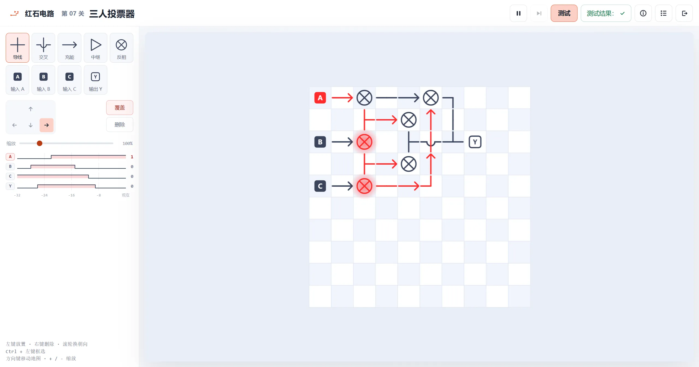
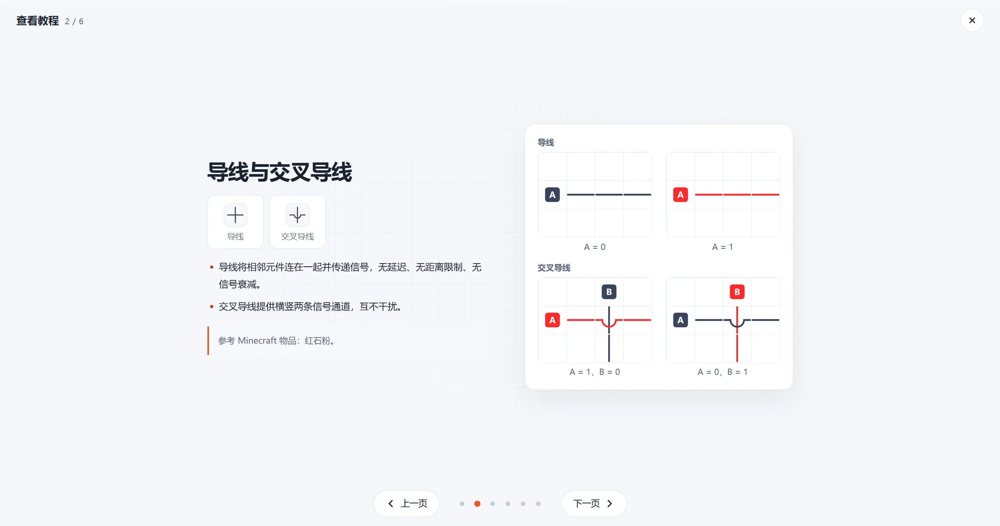

<p align="center">
  
</p>

<h1 align="center">红石电路</h1>

<p align="center">
  简化的 Minecraft 红石电路模拟器 · 2D 解谜游戏 · 教学工具
</p>

<p align="center">
  <a href="https://axiomofchoice-hjt.github.io/redstone/">在线试玩</a> ·
  <a href="https://www.zhihu.com/project/detail/723">知乎项目</a> ·
  <a href="docs/controls.md">操作说明</a> ·
  <a href="CHANGELOG.md">更新日志</a>
</p>

<p align="center">
  <a href="https://github.com/axiomofchoice-hjt/redstone/actions/workflows/deploy.yml">
    
  </a>
  <a href="LICENSE"></a>
  
  
</p>

## 简介

在网格上摆放元件、连出电路，让信号按你的逻辑走。

这是一款**简化的 Minecraft 红石电路模拟器**，也是一款 2D 解谜游戏和教学工具。全部规则由 5 种可放置元件撑起来——导线、交叉导线、充能器、中继器和反相器——再加上输入 / 输出两种关卡端口。信号以 tick 为单位同步推进，中继器和反相器带来 1 tick 延迟；导线无延迟、无衰减、无距离限制，贴边就相连。

只靠这些元件，就能搭出或门、与门、异或门、半加器、时钟、边沿检测、锁存器和触发器。**19 关**按「逻辑电路 → 脉冲电路 → 记忆电路 → 进阶」四章排开，既适合刚接触红石的玩家照着教程入门，也够老手拿来速通。

每关都有目标说明、自动化测试和参考答案。搭好电路点「测试」，逐 tick 的检查结果会告诉你过没过；没过就打开回放，对着波形和参考解一格格找问题。

## 界面

<p align="center">
  
  <br />
  <sub>第七关「三人投票器」：摆电路、拨输入、看波形</sub>
</p>

<p align="center">
  
  <br />
  <sub>图文教程第二页「导线与交叉导线」</sub>
</p>

## 关卡

| 章节 | 关卡 |
| --- | --- |
| 逻辑电路（1–7） | 导线 · 或门 · 非门 · 与门 · 异或门 · 半加器 · 三人投票器 |
| 脉冲电路（8–13） | 时钟 · 脉冲延迟器 · 脉冲延长器 · 上升沿感应器 · 脉冲过滤器 · 双边沿感应器 |
| 记忆电路（14–17） | RS 锁存器 · D 锁存器 · T 触发器 · JK 触发器 |
| 进阶（18–19） | 交叉 · 脉冲长度感应器 |

## 元件

| 元件 | 作用 |
| --- | --- |
| 导线 | 连成一片的导体，同一网络一起带电；无延迟、无衰减、无距离限制 |
| 交叉导线 | 上下 / 左右两条独立通道，各走各的，互不导通 |
| 充能器 | 朝正面一个方向给相邻元件供能 |
| 中继器 | 读后方，延迟 1 tick 输出到正面；侧面被输出 1 的中继器顶住会锁存，被输出 1 的充能器顶住会断路 |
| 反相器 | 四面都能被充能器 / 中继器正面顶住，输出也从四面送出；被顶住且对方输出 1 时输出 0，否则输出 1，延迟 1 tick |
| 输入 / 输出 | 输入按玩家拨的 0 / 1 朝四面发信号；输出收集四周信号，任意一个为 1 就是 1 |

完整规则见[元件与信号规则](docs/rules.md)。

## 特性

- **tick 同步仿真**：导线、交叉导线和充能器在同一 tick 内传播到稳定，中继器 / 反相器延迟 1 tick；中继器侧面锁存、充能器侧面断路两条规则都保留，可以直接搭出 D 锁存器和断路器。
- **测试与回放**：每关自带多组测试，逐 tick 检查输出；未通过时回放整组测试，检查区间按期望电平铺底，有参考解时并排画出参考输出，点波形就能跳到任意 tick。
- **实时波形**：每个输入 / 输出一行，显示最近 32 个 tick（约 8 秒）；点行首字母直接拨 0 / 1，不用回到地图。
- **编辑器**：连续放置 / 连续删除、桌面端 Ctrl / Cmd 框选剪切复制粘贴、0.5x–3x 缩放、数字键选元件、桌面端方向键 / WASD 平移。
- **双端布局**：宽度 ≥ 1024px 用桌面两栏布局，窄屏自动切成手机单列布局；两端共用同一份游戏状态，拖窗口跨断点不会丢电路。
- **教程与自由模式**：6 页图文教程，示例状态图由真实仿真引擎绘制；另有 20×20 自由沙盒，元件全开，没有目标和测试。
- **进度与导出**：通关记录存在浏览器 localStorage；当前地图和电路状态可以导出成 JSON。

## 快速开始

需要 Node.js 20.19+ 和 npm。

```bash
npm install
npm run dev       # http://localhost:5173
```

其他命令：

| 命令 | 说明 |
| --- | --- |
| `npm run build` | 类型检查并打包到 `dist/` |
| `npm run build:only` | 跳过类型检查直接打包 |
| `npm run preview` | 预览打包结果 |
| `npm run typecheck` | 只做 TypeScript 类型检查 |
| `npm run lint` | oxlint 静态检查 |
| `npm test` | 运行 vitest 单元测试 |

## 文档

**操作**

- [界面与操作](docs/controls.md)：两套布局、放置与删除、平移缩放、快捷键、菜单、首页与自由模式
- [放置 / 交互模式与波形图](docs/waveform.md)：拨输入、波形怎么画、采样规则
- [测试与回放](docs/testing.md)：测试按钮、结果状态、回放、点波形跳转与「上一刻」

**规则**

- [元件与信号规则](docs/rules.md)：五种元件、中继器锁存、充能器断路
- [时间模型与仿真](docs/simulation.md)：tick 推进、延迟、增量更新

**关卡**

- [关卡数据格式](docs/levels.md)：`Level` 字段、`pairs` 与测试写法、导出地图
- [各关设计说明](docs/level-notes.md)：第十八关的设计、参考解取的状态

**开发**

- [开发](docs/development.md)：技术栈、目录结构、文档对应表、约定

## 实现

- React 19 + TypeScript + Vite，画布用原生 Canvas 2D 绘制，自己处理 devicePixelRatio、平移缩放和手势。
- 仿真内核在 `src/game/sim.ts`，与 UI 解耦；日常推进走增量更新，单元测试逐 tick 和保留的全量参考实现 `snapshotFull()` 对拍。
- 关卡是纯数据，一关一个文件，关卡自带测试和参考解；`npm test` 会跑仿真、关卡行为、数据校验和配色对比度检查。
- 推送到 `main` 后，GitHub Actions 会跑测试和构建，发布到 `gh-pages`。

## 更新日志

见 [CHANGELOG.md](CHANGELOG.md)。

## 协议

[MIT](LICENSE) © 2026 axiomofchoice
